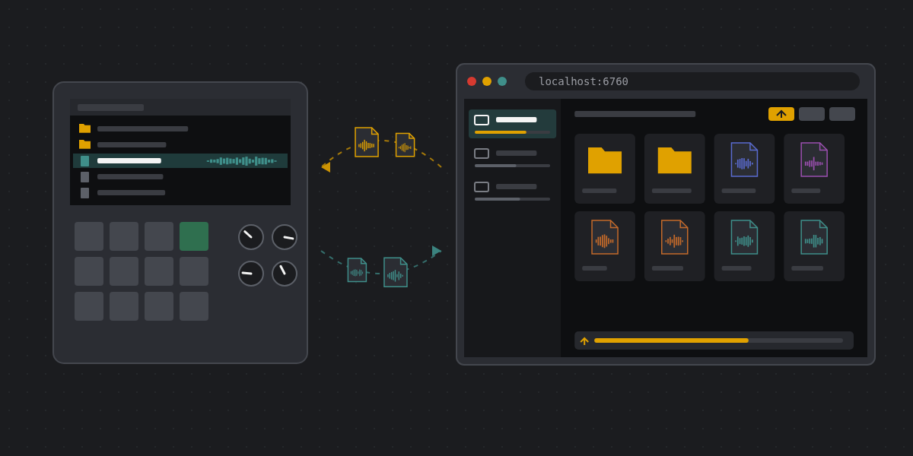
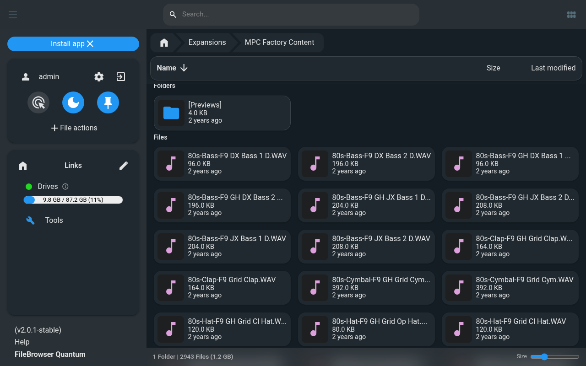
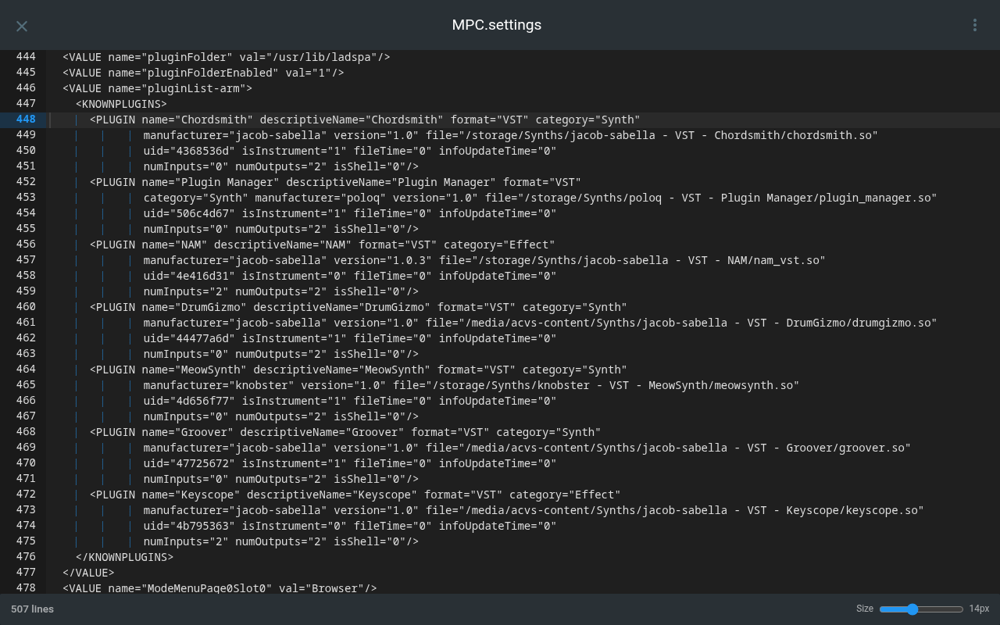
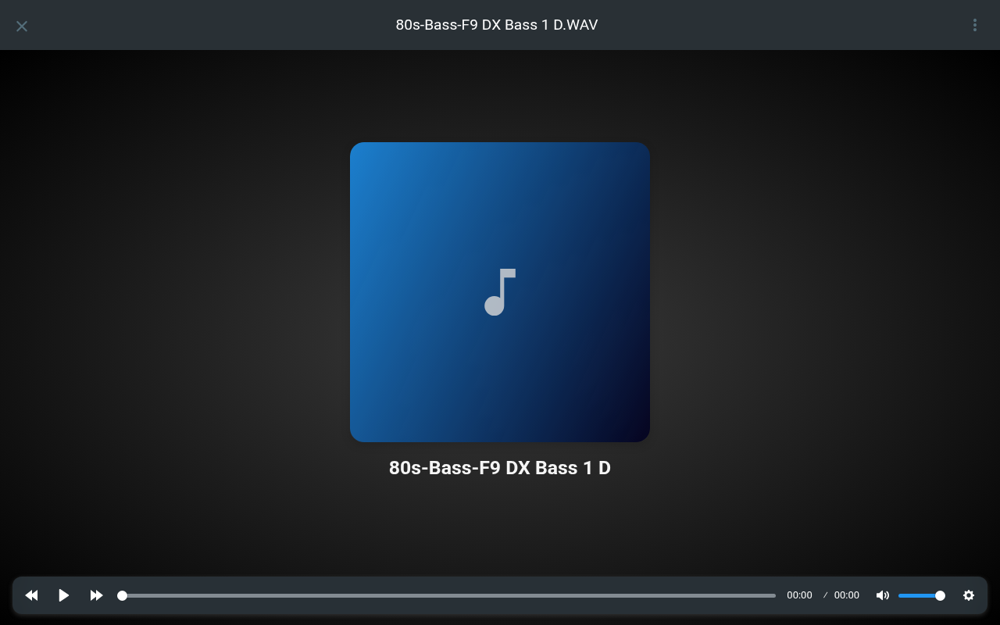
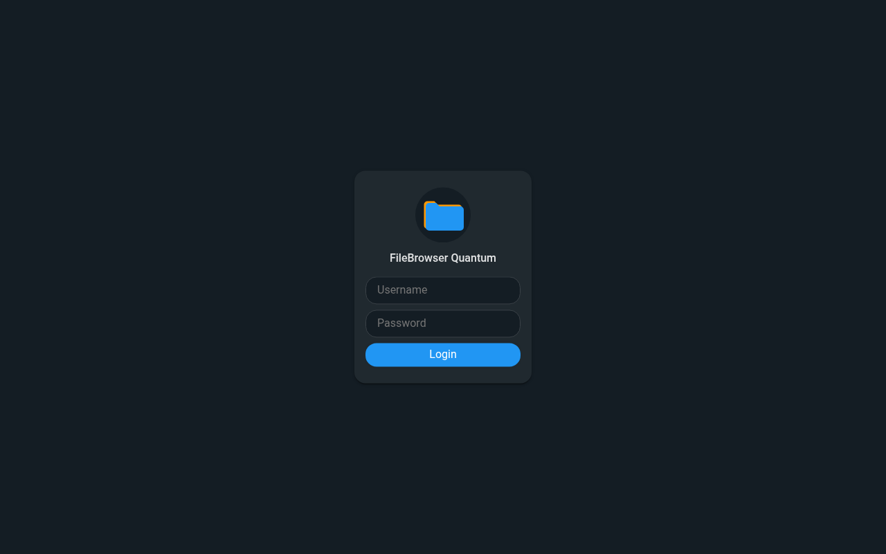
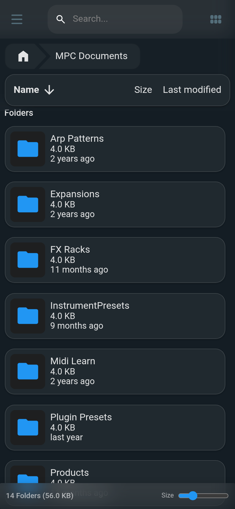

# MPC File Browser

> [!WARNING]
> **This is not a FileBrowser Quantum project.** I'm not affiliated with the FileBrowser Quantum developers, and they
> have nothing to do with this addin. It was built with AI ([Claude Code](https://claude.ai/code)). If something goes
> wrong while you're using it, please **don't report it to FileBrowser Quantum**. Open an issue
> [here](https://github.com/jacob-sabella/mpc-addin-filebrowser/issues) instead.

Your MPC's drives, in a web browser.

MPC File Browser runs [FileBrowser Quantum](https://github.com/gtsteffaniak/filebrowser) on your MPC, beside MPC itself.
Open it from a computer or phone to browse the device's drives, upload samples and projects, download your work, play
audio, edit text files, and rename, move or delete files, all without pulling the SD card. It works on MPC OS standalone
devices (MPC Live, One, X, Key and Force), Gen1 and Gen2.



## What you get

| | |
|---|---|
|  |  |
| Browsing MPC's internal storage | MPC.settings in the built-in text editor |
|  |  |
| Playing a sample in the browser | Logging in |

It works on a phone too:



All the screenshots are from an MPC Key 37, through the SSH tunnel described below.

## Connecting

For safety, FileBrowser only listens on the device itself, on port 6760. To reach it from a computer, open an SSH tunnel
and leave it running:

```sh
ssh -N -L 6760:127.0.0.1:6760 root@<device address>
```

Then open `http://localhost:6760` and log in as **admin** with the password **mpcadmin**.

Change that password straight away. You can do it in FileBrowser's own settings (it stays across MPC restarts) or with
`password=` in the addin's settings below.

If you'd rather skip the tunnel, `bind=0.0.0.0` in the settings opens FileBrowser to every network the device is on.
Change the password first: the default is the same on every device. An admin can read, change and delete every file in
the folders it shows, and the server runs as root.

## Settings

The settings file is `/data/mpc-addins/filebrowser/mpc_filebrowser_addin.conf`. It's read each time MPC starts, and an
upgrade keeps your edits.

| Key | Default | What it does |
|---|---|---|
| `enabled` | `1` | `0` starts nothing |
| `bind`, `port` | `127.0.0.1`, `6760` | where FileBrowser listens |
| `password` | `mpcadmin` | the admin's password. It's set at the first start, and again whenever this line changes. A password changed in FileBrowser's own settings stays until then. At least 5 characters, and not `admin` (FileBrowser treats that one specially) |
| `sources` | `/media:/storage` | the folders it shows, separated by `:` (listed as Drives and Storage). A folder that doesn't exist or is empty, such as a mount point with nothing mounted, is skipped. `/media` holds the internal drive on Gen1, and every SD card and USB drive on both generations |
| `index` | `0` | `1` turns on FileBrowser's search index: a full scan of the folders at each start, then rescans. It's off by default because the scan competes with MPC for the disk. Browsing, uploads and downloads work without it |
| `previews` | `1` | image thumbnails |
| `nice` | `19` | FileBrowser's CPU priority, 0 to 19 (higher is gentler). It always runs in the idle disk class too |
| `memory_mb` | `192` | a soft memory limit (Go's `GOMEMLIMIT`). It also uses at most 2 CPU cores |
| `log` | empty | a file to append FileBrowser's and the script's log to |
| `config` | empty | your own FileBrowser config file, used instead of the one written from the keys above |

The config written from these keys is `config.yaml`, in the same folder. FileBrowser's database (users and their
settings), its thumbnail cache and `password.given` (the last `password=` it was given) live there too. Uninstalling
leaves them, and so the folder, in place. Delete the folder to remove them.

## Installing

Get it from the [MPC plugin catalog](https://sd88me.github.io/mpc-vst-plugins/), or download a zip from this repo's
Releases page:

- `-mpc-armv7.zip` for Gen1: MPC Live and Live II, One, X, Key 61 and Key 37, Force
- `-mpc-aarch64.zip` for Gen2: Live III, One G2, Key G2

Unzip it and follow its `INSTALL.md`: copy the folder to the device over SSH and run `install.sh` there. You need root
shell access, and the install restarts MPC. To uninstall, run `sh /data/mpc-addins/filebrowser/uninstall.sh`.

Tested on an MPC Key 37 (Gen1) beside MPC (2026-10-23; see `tested.json`). Gen2 is tested offline only: the host tests
and the real FileBrowser binary pass for both device CPUs under QEMU (`tests/`), and both zips pass the catalog check.

## How it works

MPC File Browser is an **addin**: a small shared library that MPC loads as it starts, through `LD_PRELOAD`. The library
does one thing. As MPC starts, it launches `filebrowser-run.sh` from its folder as a separate process and returns. The
script runs FileBrowser Quantum (its own static binary, in the same folder), restarts it if it exits, and stops it when
MPC exits. So FileBrowser runs exactly as long as MPC does, and installing, upgrading and removing it work like any
other addin.

### Why the library starts a program

The catalog flags the library for calling `fork` and `execve`. That's how it starts the script: a double fork, so MPC
never has to wait for it or reap it. Everything is prepared before the first fork, and only plain system calls run
between fork and exec. The script runs in its own session, without `LD_PRELOAD` (so FileBrowser doesn't load the
addins), with every signal at its default, at the `nice` value and in the idle disk class. The library does nothing in a
process whose executable isn't named `MPC`.

## How it's built

This repo contains **none of FileBrowser Quantum's code or binaries**. `upstream.env` names the release and the SHA-256
of its files, and the build downloads them and refuses anything that doesn't match.

```sh
./build.sh            # Gen1: build/
./build.sh aarch64    # Gen2: build/aarch64/
tests/test.sh         # host tests: the library and the script (sh, and BusyBox when installed)
tests/smoke.sh armv7  # the real FileBrowser binary run by the script under QEMU (and: aarch64)
```

`build.sh` compiles the library in Docker (QEMU for the target CPU; Gen1 against glibc 2.31, so it loads on older MPC
OS) and runs `tools/fetch-upstream.sh`, which downloads FileBrowser's binary and licence and checks them against
`upstream.env`.

Releases come from CI. Run the Release workflow with a version, and it attaches both zips to a draft release. Install
that zip on a device, then publish the draft (as a prerelease while the version is 0.x).

### Updating FileBrowser

The Upstream workflow runs daily. When FileBrowser Quantum has a newer `-stable` release (its `-beta` releases are
ignored), the workflow moves `upstream.env` to it, builds and tests both packages with it, and opens a pull request
that links the test run. Read upstream's release notes for config changes, merge, and run Release with a new version.
To move to a specific tag, run Upstream by hand with that tag, or locally: `tools/upstream-check.sh <tag>`.

## Vibe Coded

This project was built with [Claude Code](https://claude.ai/code): the addin library, the launch script, the settings
handling, the tests and the build tooling. FileBrowser Quantum itself is the unmodified upstream release.

## Credits and license

FileBrowser Quantum is by its authors, under Apache-2.0. Its licence ships in every zip as `LICENSE-filebrowser`, and
the binary is the unmodified upstream release. This repo only packages it for the MPC.

This repo is MIT.
